# User flows

Every flow below is drawn from the redesign specs. IDs in brackets are the
spec state IDs (README in `docs/design/redesign/` lists the prefixes). A line
marked **Decision D-nn** is a proposal made while writing this folder; see
`03-decisions-and-open-questions.md`.

Roles: **Independent tutor** (one person, full rights), **Agency admin**,
**Agency tutor** (only their own courses), **Student** (with account), and
**Student without email** (links only).

---

## 00 · The whole product on one page

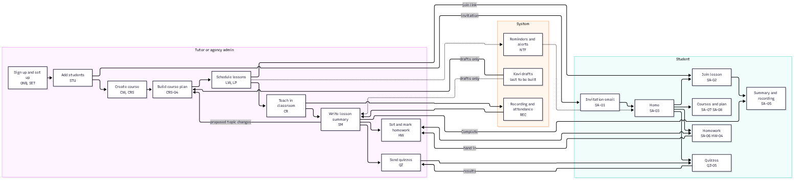

The tutor builds the structure (students, course, plan, lessons). The student
app mirrors it. Kavi only drafts; it never changes anything by itself, and it is
built last, so every screen must work without it.

---

## 01 · Sign up and set up

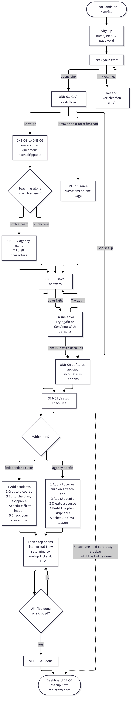

- Sign-up and email-confirmation screens are not in the specs yet. The flow
  follows the standard pattern. **Decision D-01.**
- Kavi's five onboarding questions are fixed text, not AI. "Answer as a form"
  (ONB-11) is the same five questions on one page, saved the same way.
- Everything can be skipped. Skipping applies the defaults in ONB-09 and the
  setup list stays in the sidebar until done.
- Only "Build the course plan" can be skipped on the setup list. Sample data
  never ticks a step.
- Edge cases: save failure (ONB-08), team owner who skips the questions ends up
  on the solo list and can switch in Settings (12 CFG-T).
- Specs: 02, 12 (CFG-T, CFG-L).

## 02 · Log in, recover, and expiry

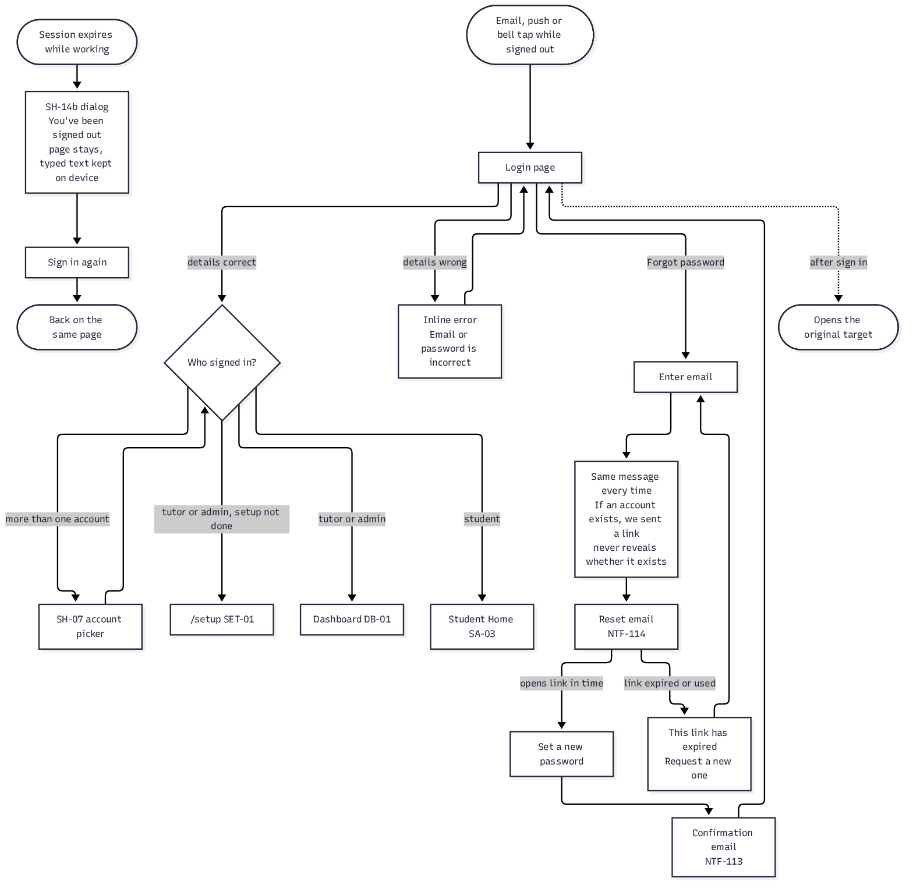

- Forgot-password gives the same message whether or not the email has an
  account, so nobody can probe for accounts. **Decision D-01.**
- When a session runs out mid-work the page stays, typed text is kept on the
  device, and signing in returns to the same page (01 SH-14b). In the classroom
  the lesson keeps running and Lesson tools offers an in-place sign-in.
- Opening a link from an email or push while signed out sends the person to
  sign in and then to the target.

## 03 · Invitations (student, tutor, admin)

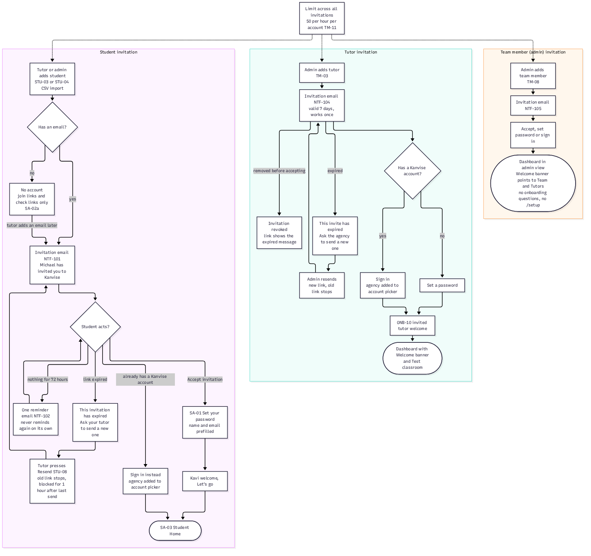

- Students join by invitation only. There is no self sign-up.
- A student with no email has no account. Join links and check links are
  their only way in. They get no homework, quizzes, summaries or recordings in
  Kanvise until an email is added. The tutor can Copy a summary to WhatsApp.
- Invitation limits: 50 an hour across all invitation types (19 TM-11). Tutor
  links last 7 days and work once. **Decision D-12** gives students the same.
- A resend makes a new link and the old one stops at once.
- Invited admins skip onboarding and `/setup`. **Decision D-03.**
- Specs: 06 (STU-03, STU-07 to STU-09), 19 (TM-03, TM-08, TM-11), 18
  (NTF-101 to NTF-107), 09 (SA-01), 02 (ONB-10).

## 04 · Create a course and its plan

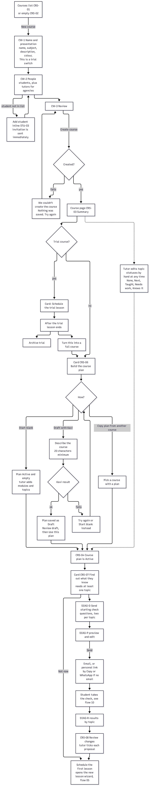

- A course is one subject, one or more students, one or more tutors. Every
  lesson belongs to a course. A trial is a short course.
- The course plan (modules, topics, objectives) is owned by the tutor. Kavi can
  draft it, but the tutor reviews and presses **Use this plan**.
- The starting check is a short multiple-choice check per topic. Its results
  are proposals; nothing changes until the tutor ticks rows in **Review
  changes** (CRS-08).
- Several tutors can be on a course, but each lesson has exactly one.
  **Decision D-04.**
- Specs: 04 (CW-1 to CW-3, CRS-01 to CRS-08, DIAG-*), 06 (STU-03), 19 (TM-03).

## 05 · Schedule, change and cancel lessons

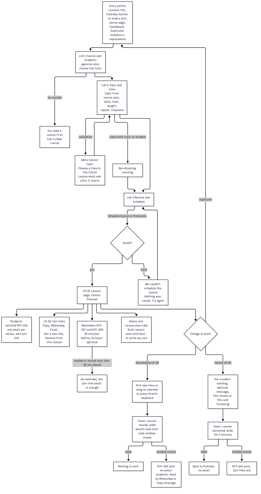

- Messages caused by an action with an **Undo** toast are held until the toast
  closes, the tutor leaves the page, or 5 minutes pass. If several changes
  stack up, only the last state is sent (18 NTF-03).
- A series keeps its time of day in the lesson's timezone (max 52 lessons).
  Editing one lesson makes an exception; **This and following** splits the
  series.
- Join links stop working when the undo window closes after a cancel, so an
  Undo brings the same links back. **Decision D-13.**
- Specs: 05 (LW-1 to LW-3, LP-01 to LP-05, CAL-01 to CAL-07), 18 (NTF-201 to
  NTF-208, NTF-03).

## 06 · Lesson day

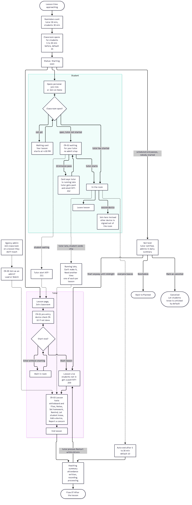

- There is no admit step or waiting room. Once the tutor has started, a
  student's link goes straight in. Before that the student sees a waiting card.
- If nobody starts within 10 minutes, the student's card says the tutor is
  running late and the tutor gets a push and email.
- If everyone leaves, the room ends itself after 5 to 30 minutes (default 10).
  The tutor can restart within 60 minutes.
- A lesson nobody started becomes **Not held** at its scheduled end. The tutor
  can still **Start anyway** until midnight in the lesson's timezone.
- An admin who is not the lesson's tutor sees **Join as an admin?** and chooses
  Lead or Watch. Their attendance does not count as the tutor's.
- Specs: 07 (CR-01 to CR-14), 17, 18 (NTF-209 to NTF-218), 12 (CFG-L).

## 07 · After the lesson

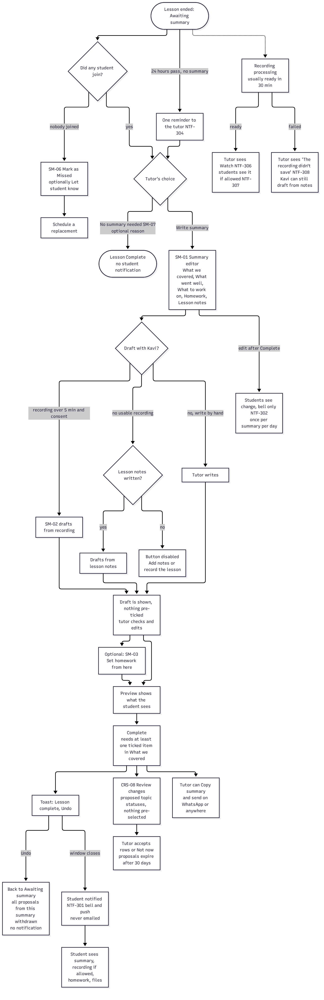

- The summary has five parts: What we covered, What went well, What to work
  on, Homework, and Lesson notes (tutor only, never shown to students, never in
  Preview or Copy).
- The student sees the summary only after **Complete** and the undo window. It
  is never emailed. The tutor decides when (press Complete) and can also Copy
  it to WhatsApp or anywhere.
- Complete proposes topic status changes. **Undo** withdraws them all.
- Specs: 08 (SM-01 to SM-07), 04 (CRS-08), 17, 18 (NTF-301 to NTF-308).

## 08 · Homework

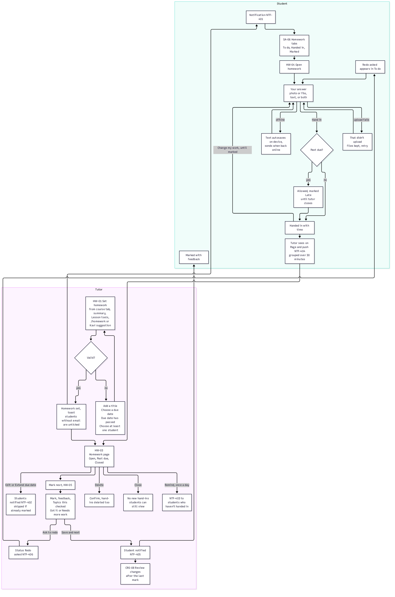

- Late hand-ins are allowed and flagged **Late** until the tutor closes the
  homework. **Decision D-06.**
- Students without an email cannot receive homework in Kanvise. They are
  unticked in the form with the reason shown.
- Specs: 10 (HW-01 to HW-05), 09 (SA-06), 15 (upload limits), 18 (NTF-401 to
  NTF-406).

## 09 · Quizzes

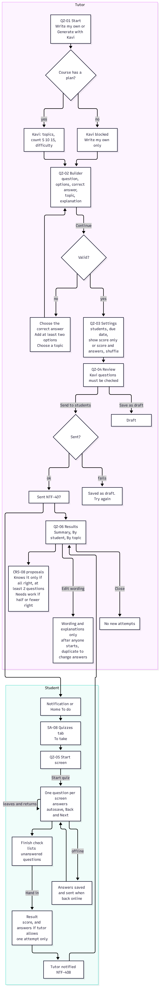

- Multiple choice, one attempt, no time limit in this version.
- A student can still start a quiz after its due date until the tutor closes
  it, and it is marked Late. In-progress attempts can always be finished.
  **Decision D-07.**
- Kavi-written questions carry a warning until the tutor checks them.
- Specs: 11 (QZ-01 to QZ-06), 09 (SA-08), 18 (NTF-407, NTF-408).

## 10 · Starting check (student side)

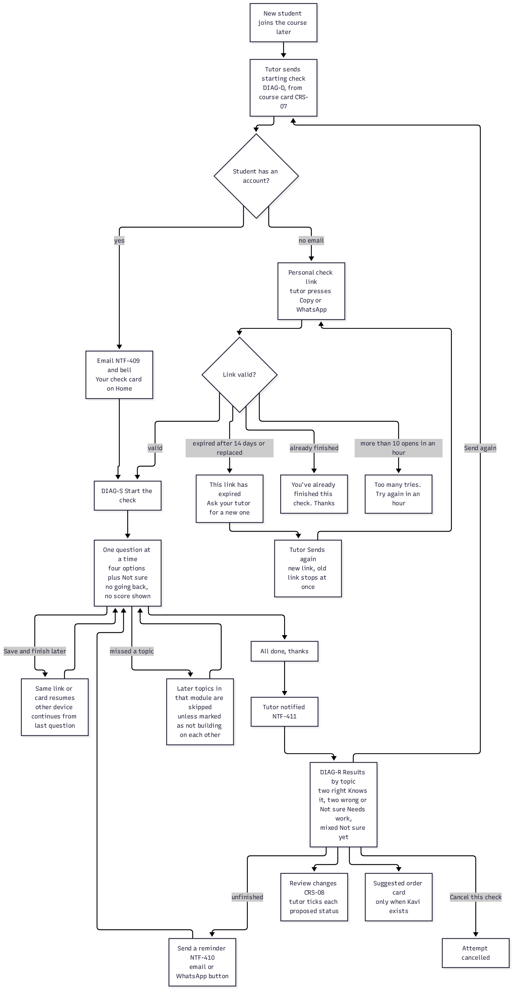

- A student with an account takes it signed in. Anyone else uses a personal
  check link that lasts 14 days, covers one student, and is replaced when the
  tutor sends again.
- No score is shown to the student.
- Specs: 04 (DIAG-D, DIAG-P, DIAG-S, DIAG-R), 18 (NTF-409 to NTF-411).

## 11 · Admin, team and "I teach too"

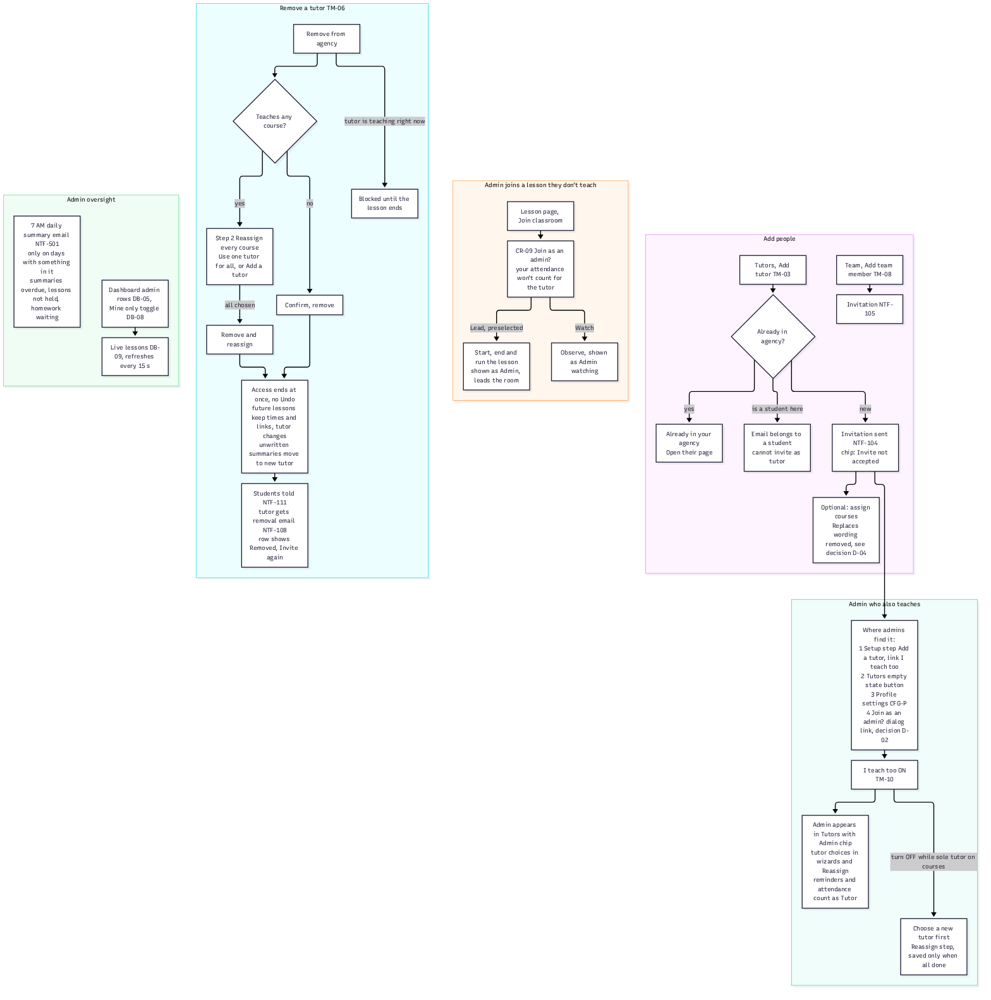

- An admin who also teaches turns on **I teach too** in their profile settings.
  It is the same account, not a second one. Bobbin instead tells the admin to
  join from a separate tutor account; Kanvise chose one account.
- Where an admin finds it: the setup step "Add a tutor", the Tutors empty
  state, profile settings, and (proposed) the Join as an admin dialog.
  **Decision D-02.**
- Removing a tutor who teaches courses forces a reassign step. Removal cannot
  be undone, and is blocked while the tutor is teaching a lesson.
- Specs: 19 (TM-01 to TM-11), 12 (CFG-P), 07 (CR-09), 03 (DB-05, DB-08, DB-09),
  18 (NTF-501).

## 12 · Student week

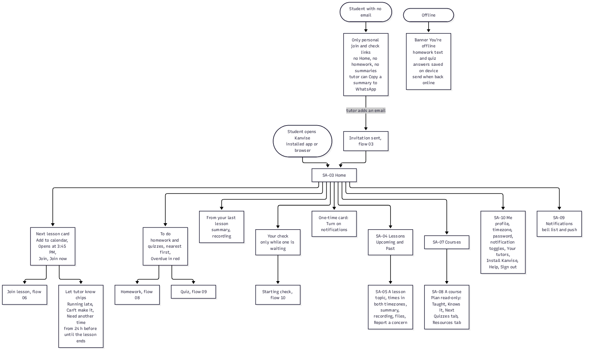

- The student app is a phone-first PWA. Home answers "what's next?" in one tap.
- A student with several tutors sees one Home, with courses grouped by tutor
  and a tutor filter. **Decision D-05.**
- Specs: 09 (SA-01 to SA-10), 16 (responsive rules).

## 13 · Payments (proposal, not built)

See `04-payments.md`.

## 14 · Motivation and progress (proposal, not built)

See `05-gamification.md`.

---

## Role and permission matrix

| Can they... | Independent tutor | Agency admin | Agency tutor | Student |
|---|---|---|---|---|
| Create courses, add students | Yes | Yes | No | No |
| See all courses in the account | Yes | Yes | Only theirs | Only their own |
| Invite tutors and team | n/a | Yes | No | No |
| Teach a lesson as the tutor | Yes | Only with I teach too | Their own | No |
| Join someone else's lesson | n/a | Yes, Lead or Watch | No | No |
| Complete a summary | Yes | Yes | Their own lessons | No |
| See private lesson and student notes | Yes | Yes | Their own courses | Never |
| See recordings list, export, delete | Yes | Yes | Own courses, no export or delete | Watch only if allowed |
| Settings | All | All | Personal only | Me page |
| Tutors and Team pages | Not available | Yes | Not available | No |

Anything a person is not allowed to open shows the same "Not available" page
(01 SH-14a), whether the thing exists or not.
