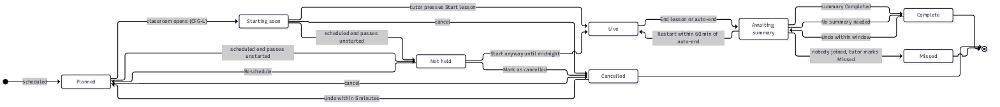
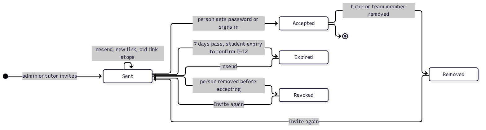
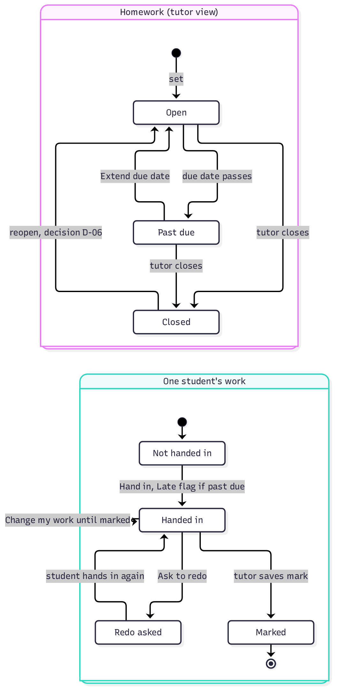
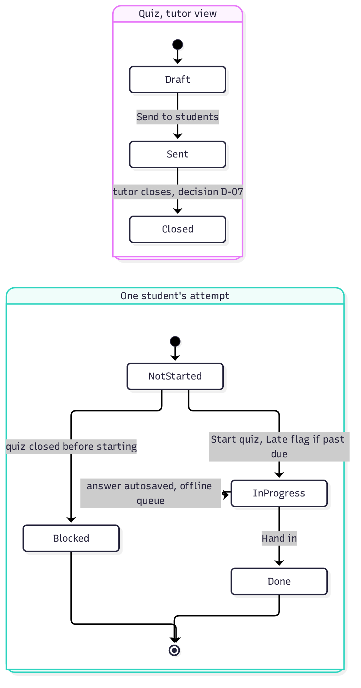
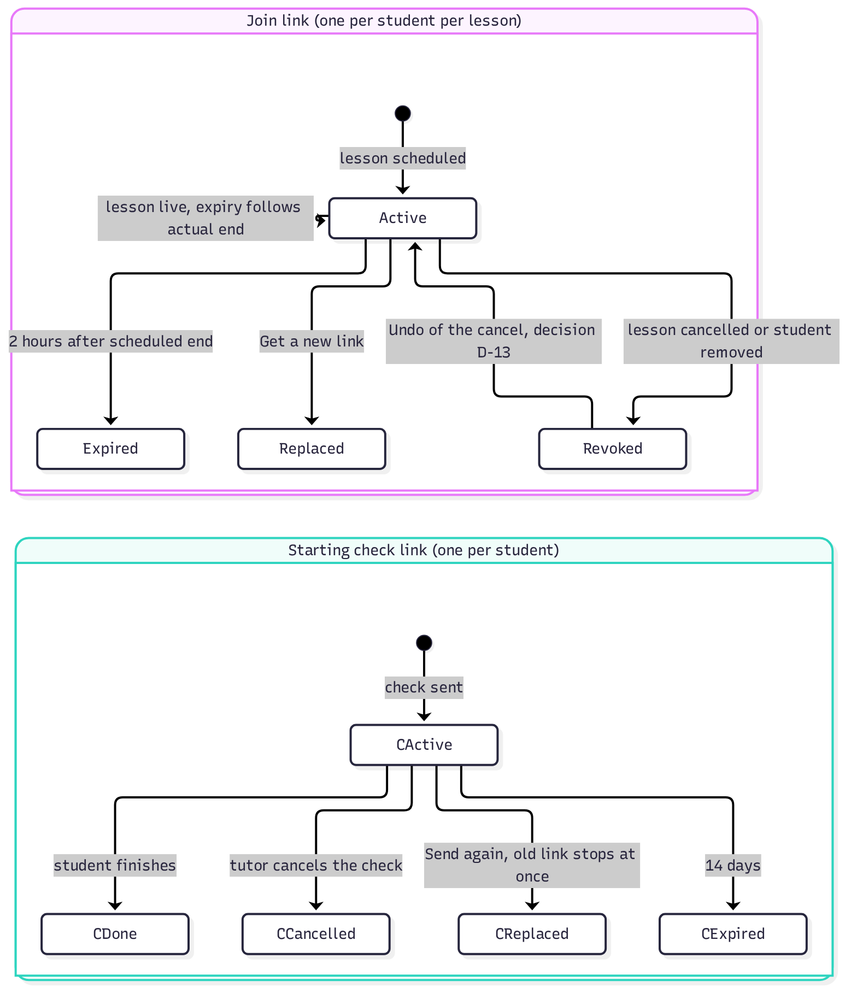
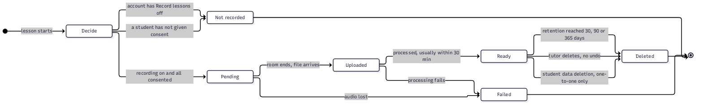
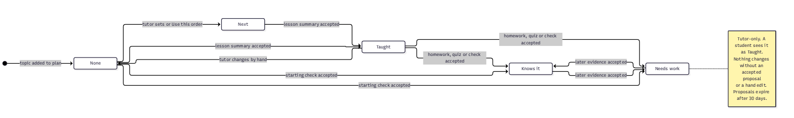
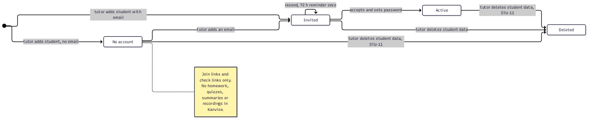
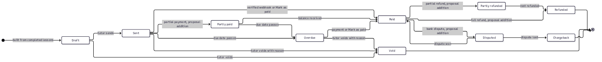

# State machines

A flow shows what a person does. A state machine shows what a thing is at any
moment and what is allowed to change it. Devs turn these into enums and guard
rules, and QA turns every arrow into a test.

## Lesson

| State | Meaning | Notes |
|---|---|---|
| Planned | Scheduled | |
| Starting soon | Classroom is open to students | Not stored. Worked out from the time and CFG-L "Classroom opens" (5, 10, 15 or 30 min) |
| Live | Tutor pressed Start lesson | |
| Awaiting summary | Lesson ended, summary not done | Restart allowed for 60 min after an automatic end |
| Complete | Summary completed, or No summary needed | |
| Missed | Nobody joined, tutor marked it | Different from a student's attendance status "Missed" |
| Not held | Scheduled end passed and nobody started | Set by a job. Start anyway until midnight (lesson timezone) |
| Cancelled | Cancelled by the tutor or admin | Undo for 5 minutes |

## Invitation

Applies to students, tutors and team members. Tutor and team links last 7 days
and work once. Student expiry is proposed to match (**D-12**).

## Homework and the student's work

## Quiz and one attempt

## Join link and check link

A join link is per student per lesson. Only one device can be connected at a
time; **Join here instead** moves the connection. A check link is per student
and is replaced by **Send again**.

## Recording

Not recorded has three reasons the tutor can see: recording switched off in
settings, a student without consent, or both. Students are only told "No
recording for this lesson" (**D-08**).

## Topic status (course plan)

Needs work is tutor-only. A student sees it as Taught. Status never changes on
its own: a summary, homework mark, quiz or starting check only proposes a
change, and the tutor accepts it in Review changes.

## Student account

## Invoice (proposal)

Draft, Sent, Paid, Overdue and Void come from `13-billing.md`. Partly paid,
Refunded, Partly refunded, Disputed and Chargeback are additions proposed in
`04-payments.md`.
