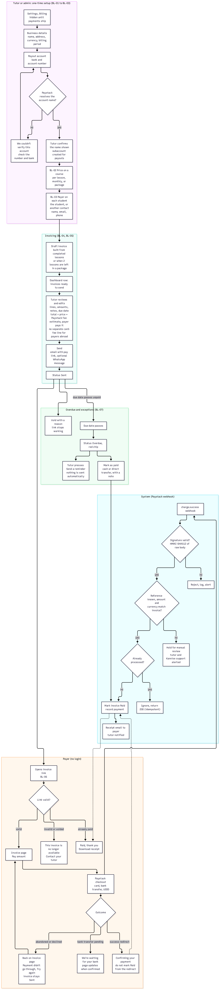
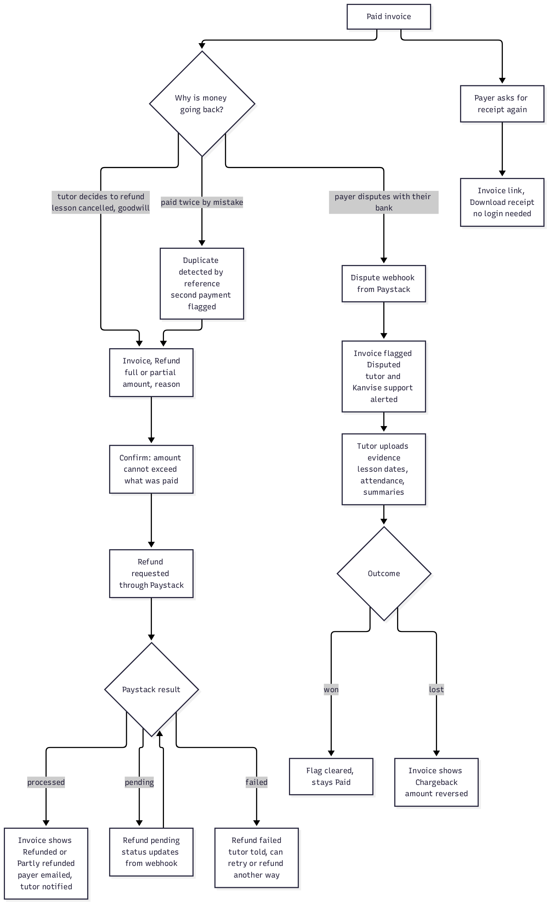
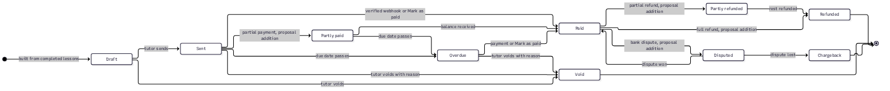

# Payments flow

Status: **proposal, not built.** It extends `docs/design/redesign/13-billing.md`
(invoice with a Pay button, paid through Paystack, on hold until the owner's
payments revamp). Section numbers below that say "BL-" are that spec's IDs.
This file adds the failure paths, money-safety rules, refunds and disputes that
the spec leaves open. It follows common practice for invoicing and Paystack
integrations (**decision D-15**).

## What stays as in spec 13

- Tutors and agency admins bill. Whoever pays gets an invoice link and pays with
  no account (BL-06).
- The payer is the student, or an "other contact" (name, email, phone) who has no
  account (BL-03).
- Prices are per lesson, monthly, or a package (BL-02). Billing period is monthly
  (default), every two weeks, or after each lesson (BL-01).
- Draft invoices come from completed lessons. The tutor reviews and sends.
  Nothing is sent automatically (BL-04, BL-05, BL-07).
- Kavi is not involved.

## Flow

## Refunds and disputes

## Invoice states

Spec 13 has Draft, Sent, Paid, Overdue and Void. This proposal adds **Partly
paid**, **Refunded**, **Partly refunded**, **Disputed** and **Chargeback**,
because real payments produce them.

## Money-safety rules

These matter more than the screens. Devs should treat them as acceptance
criteria.

1. **A redirect never marks an invoice Paid.** After checkout the payer lands on
   the invoice page showing "Confirming your payment". Only a verified server
   event or a server-side verify call changes the status.
2. **Verify every webhook.** Paystack signs each webhook with an HMAC-SHA512 of
   the raw request body, keyed with the secret key, sent in the
   `x-paystack-signature` header ([Hookdeck guide](https://hookdeck.com/webhooks/paystack/verify)).
   Reject anything that does not match, using a constant-time comparison.
3. **Check the amount and currency.** The event's reference, amount and currency
   must match the invoice. A mismatch goes to manual review and never marks it
   Paid.
4. **Be idempotent.** Webhooks can arrive more than once. Store the Paystack
   reference and process each once; a repeat returns success and does nothing
   ([Paystack idempotency walkthrough](https://dev.to/gloriasilver/paystack-integration-series-2-how-to-verify-payments-with-webhooks-and-handle-idempotency-1222)).
5. **Amounts in the smallest unit.** Paystack takes subunits, so NGN 100 is sent
   as 10000 ([Paystack currencies](https://paystack.com/docs/v2/api/supported-currencies)).
   Store integers, never floats.
6. **A reconciliation job.** If a webhook is missed, a job asks Paystack about
   every Sent invoice with an open payment attempt and updates it.
7. **Invoice links are unguessable and revocable.** Use random tokens stored
   hashed, as the other personal links do (00 section 18). Voiding an invoice
   kills its link.
8. **Audit trail.** Every status change records who or what did it and when.
9. **Secrets** live in the environment, never in code or logs (existing
   `api/src/config/payment-secrets.ts` already handles this for payments).

## Payouts to the tutor

Paystack subaccounts let one account split settlement between a main account and
subaccounts ([Paystack split payments](https://paystack.com/docs/payments/split-payments/)).
The design uses one subaccount per tutor (or per agency) so money lands in their
bank account, after verifying the account name on setup (BL-01). Same-day
payout, which the old Experience document promised, depends on Paystack's
settlement schedule for the account, so do not promise "same day" in the UI
until it is confirmed with Paystack.

## Refunds

- Tutor opens a paid invoice, **Refund**, enters an amount (up to what was paid)
  and a reason. Paystack lets a refund be partial but never more than the
  original ([Paystack refund API](https://paystack.com/docs/api/refund/)).
- Statuses: Partly refunded, Refunded. A pending or failed refund is shown, with
  Retry.
- Cancelling a lesson never refunds by itself. Charging or refunding for late
  cancellations stays out of scope, as in 13.

## Disputes

If a payer disputes a card payment with their bank, Paystack notifies Kanvise.
The invoice is flagged **Disputed**, the tutor and Kanvise support are alerted,
and the tutor can attach evidence from records Kanvise already has (lesson
dates, attendance, summaries). Outcome: won (stays Paid) or lost (Chargeback).

## Fees (decision D-21)

The owner decided on 28 Nov that **the payer pays Paystack's processing fee**.
Kanvise's own fee is decided later (OQ-02), and the design leaves room for it as
a separate line.

How it works:

- The invoice total is the tutor's price plus the processing fee, so the tutor
  receives the full price for their lessons. The invoice shows the price, the
  fee and the total. Paystack can also be set so a subaccount, not the main
  account, bears its fees ([Paystack transaction API](https://paystack.com/docs/api/transaction/)),
  but that moves the fee to the tutor, so it is not used here.
- Paystack's fee depends on the card. For a Nigeria-based business Paystack lists
  3.9% plus NGN 100 for international cards charged in NGN, and 3.9% for USD
  ([Paystack: international payments](https://support.paystack.com/en/articles/2130690)).
  Local card rates are different and not on that page. Kanvise does not know the
  card until the payer pays, so the fee on the invoice is an **estimate by payer
  region** (local or international), worked out when the invoice is drafted, in
  whole subunits and rounded up.
- If the real fee differs from the estimate, the difference is settled in
  Kanvise's own fee later. Nobody is asked for a second payment. (OQ-11.)
- A tutor can see the fee before they send, and can change the payer's region.

**UK rule to check before building.** Since 13 January 2018 UK shops may not
charge consumers extra for paying by debit or credit card
([GOV.UK](https://www.gov.uk/government/news/card-surcharge-ban-means-no-more-nasty-surprises-for-shoppers)).
A separate "card fee" line on an invoice to a UK family could break that rule.
The safer design for payers abroad is one total, with the processing cost built
into the price the tutor sees and agrees, and no separate card-fee line. Other
countries may have similar rules, and this needs a lawyer's check (OQ-11). I am
not giving legal advice.

## Currency

Paystack's support page on international payments says:

- Customers anywhere can pay with Mastercard, Visa or Verve cards. A business
  has to switch international payments on and pass Paystack's checks first.
- By default the charge and the payout are in the business's own currency. The
  payer's bank converts. So a UK family can pay a Nigerian-priced invoice with
  their card.
- Nigeria-based businesses can also be paid in USD, but need a Zenith Bank USD
  domiciliary account for USD payouts.
- GBP is not listed as a currency a business can price in.

So families abroad can pay. The open choice is what price they see: NGN, with
their bank converting, or USD if a USD account is set up. Recommendation: show
NGN to Nigerian payers, and USD to payers abroad once the USD account exists.
Until then, NGN for everyone.

**Who holds the Paystack account (owner, 28 Nov).** Kanvise does. Kanvise is the
merchant, handles everything with Paystack (activation, international payments,
fees, disputes), and pays tutors out. Tutors and agencies never open a Paystack
account. In Paystack terms each organisation gets a subaccount for its payout
bank account, and Kanvise's own account takes each payment before splitting it.

## Notifications to add to spec 18

| New message | Who | Channels |
|---|---|---|
| Invoice sent | Payer | Email, with the pay button |
| Payment received, with receipt | Payer | Email |
| Payment received | Tutor | Page, push |
| Payment failed or abandoned | Nobody (the payer sees it on the page) | none |
| Refund processed | Payer | Email |
| Dispute opened | Tutor | Email, push |
| Invoice overdue | Tutor only (never auto-chases the payer) | Page, in the daily summary |

## Screens still to design

BL-01 to BL-07 exist in 13. New: payment pending page, payment failed state on
the invoice page, Refund dialog, Dispute banner and evidence upload, invoice
history on the student page.

## Open questions (owner)

- **OQ-01** The price payers abroad see (above).
- **OQ-02** Kanvise's own fee, later. The Paystack fee is paid by the payer (D-21).
- **OQ-11** How the fee line is shown and settled: estimate by region, UK card
  surcharge rule, and the difference between estimate and real fee.
- **OQ-12** Payout account per organisation (see `06-account-types.md`).

## Test ideas

See `qa/01-qa-test-plan.md`, section PAY. The money-safety rules above each
become a test.
