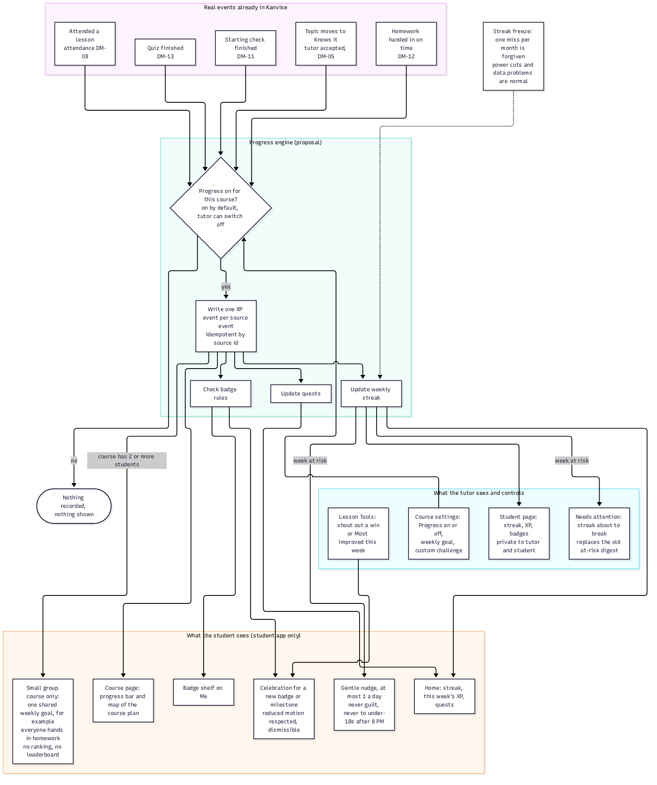

# Progress and motivation (gamification)

Status: **proposal, not in the redesign specs.** The redesign retired the
avatar builder, cohort programmes and the old XP, league and mascot ideas from
`THE KANVISE EXPERIENCE.md` (00-decisions section 15). This file designs what
could replace them, grounded in research and in who Kanvise is for now. The owner
agreed to the direction (**D-16**) and decided it is **on by default** (**D-20**).
Details below still need review before any build ticket.

## Why the old design does not fit

The old document assumed a tutorial centre with a whole cohort per class:
leagues, a class leaderboard, peer nudges ("Chidi just overtook you"), and
guilt-trip notifications. Kanvise now serves independent tutors first, with
one-to-one lessons or small groups, and agencies second.

- **A leaderboard needs a crowd.** With one student there is nothing to rank
  against. With two to five students a ranking is just naming a loser.
- **Daily streaks do not match lessons.** Lessons are scheduled once to a few
  times a week, so a daily streak would punish students for days when there is
  nothing to do.
- **Students are children, teens and adults, often on phones and paid data.**
  Heavy animation and pressure notifications cost data and can hurt young users.

## What the research says (and how it shapes the design)

| Finding | Source | What we do about it |
|---|---|---|
| Gamification tends to raise engagement and participation, but results depend on context, and over-relying on extrinsic rewards ("pointsification") weakens learning | [Systematic review, distance education, 2026](https://www.mdpi.com/2227-7102/16/8/1200) | Every point comes from a real learning action. No points for logging in or clicking |
| Leaderboards can help but the effect is inconsistent across studies, and most were in higher education | [Systematic review of leaderboards](https://www.researchgate.net/publication/369118313_The_use_of_leaderboards_in_gamified_educational_settings_A_systematic_review) | **No leaderboard.** Compare a student with their own past, not with other children |
| In a field experiment with elementary pupils, badges and leaderboards raised motivation but did not differ from each other | [Action research, elementary school](https://journals.sagepub.com/doi/10.1177/10468781241237389) | Badges give the same lift without ranking, so use badges |
| Motivation from gamification can fade over the long run | [Review, high school and higher education](https://www.cell.com/heliyon/fulltext/S2405-8440(23)06241-2) | Keep it light, tutor-controlled and easy to turn off. Do not build the product around it |
| A gamified tutoring system improved maths self-efficacy but not measured achievement | [Mixed-method study](https://link.springer.com/article/10.1007/s10763-026-10711-w) | Judge success by habits we can measure (homework on time, attendance), not by promised score gains |
| Streaks work through loss aversion, but a broken streak after illness or travel can demoralise and cause abandonment | [Push notification strategy for learning apps](https://winsomemarketing.com/edtech-marketing/push-notification-strategy-for-learning-apps) | Weekly streak, a monthly forgiveness (freeze), and a kind comeback message. No guilt copy |
| Duolingo's streak is credited with big retention gains and is also widely criticised as manipulative | [Analysis of Duolingo's streak](https://note.com/octolens/n/ne0fdd672a922?hl=en) | Copy the mechanic's good parts (visible progress, forgiveness). Leave out the pressure |

Content was rephrased for compliance with licensing restrictions. The studies
differ in age group and setting, so treat this as direction, not proof for
Kanvise. Measure after launch (see "How we know it works").

## Principles

1. **Tied to learning.** Points and badges come from events Kanvise already
   records: attending, handing in homework, finishing quizzes and checks, and a
   topic reaching Knows it.
2. **Private by default.** A student sees their own progress. The tutor sees it
   too. Nobody else does.
3. **Compare with yourself.** Personal bests, progress bars, "your best week".
4. **On by default, and the tutor is in charge.** Progress is on for every new
   course (owner decision D-20), because most students benefit and it asks the
   tutor for nothing. The tutor can switch it off for a course, or for the whole
   account, at any time.
5. **No shame.** No guilt notifications, no lives that lock learning, no
   public lists of who is behind.
6. **Light on data and eyes.** Respect reduced motion and data-saver settings,
   as onboarding already does (02).
7. **Separate from marks.** Lesson summaries have no scoring (00 section 6).
   Progress never appears in a summary or in Copy.

## What is included

| Element | How it works here | Replaces |
|---|---|---|
| **Progress bar and course map** | Topics covered out of total (already in 09 SA-07, SA-08). The map shows modules and topics from the course plan, with Taught and Knows it filled in. Topics are not locked, because the tutor owns the order | Old skill tree and unlocks |
| **XP** | Small fixed points per real action (table below). Shown as "this week" and "total" | Old XP system |
| **Weekly streak** | A week counts when the student did everything scheduled for them that week: attended each lesson and handed in due homework. One forgiven week a month (freeze) | Old daily streak |
| **Quests** | Up to 3 on Home, made from what is actually due: "Hand in Friday's homework", "Take the Algebra quiz". They ARE the To do list, shown as goals. No invented chores | Old daily quests |
| **Badges** | Milestones: first lesson, 4 weeks in a row, first quiz 100%, 5 homeworks on time, a topic moved from Needs work to Knows it, first check done | Old badges |
| **Celebration** | One short animation for a new badge or milestone, dismissible, skipped under reduced motion or data saver | Old milestone celebrations |
| **Shared goal (small groups)** | One weekly goal for the whole course: "everyone hands in this week's homework". Shows progress as a group bar and no names ranked | Old league and cohort leaderboard |
| **Tutor shout-out** | In Lesson tools or the summary, the tutor can name a win ("most improved this week"). It is a message from a person, not a score | Old Most Improved spotlight |
| **Tutor challenge** | The tutor sets a custom weekly goal for one student or the course | Old tutor-set challenges |
| **Streak at risk** (tutor) | A Needs attention row: "Alex may miss their weekly streak", so the tutor can send a personal message | Old at-risk digest |

### XP table (starting values, tune after launch)

| Action | XP | Counts once per |
|---|---|---|
| Attend a lesson | 10 | lesson (Attended or Late; not Left early alone) |
| Hand in homework on time | 15 | homework |
| Hand in homework late | 5 | homework |
| Finish a quiz | 10, plus 1 per correct answer, max 10 | quiz |
| Finish the starting check | 5 | check |
| A topic moves to Knows it (tutor accepted) | 20 | topic |

XP is never taken away. A redo gives no extra XP for the same homework.

## What is left out, and why

- **Leaderboards, leagues, rank titles.** Weak with one to five students, mixed
  evidence, and a risk of shaming young students.
- **Hearts or lives and forced review.** Locking a child out of a lesson topic
  because of wrong answers conflicts with a tutor teaching a plan they own.
- **Boss battles and gated unlocks.** The course plan belongs to the tutor.
- **Guilt-trip notifications.** Notifications are already tightly limited
  (18 NTF-02 and NTF-09). A progress nudge is at most one a day, never to a
  student under 18 after 8 PM local time, and always on a "keep going" tone.
- **Animated mascot avatars.** The avatar builder is retired. A profile photo
  upload replaces it. Kavi is the tutor's assistant, and the student app has no
  Kavi feature (09), so Kavi is not the mascot either. Open question **OQ-04**.

## Flow

## Screens to design (not in the specs yet)

| ID (proposed) | Screen | Notes |
|---|---|---|
| GM-01 | Student Home: streak, week XP, quests | Sits under Next lesson and To do on SA-03 |
| GM-02 | Course map | Added to SA-08 Plan tab |
| GM-03 | Badge shelf | On SA-10 Me |
| GM-04 | Celebration | Dialog or full-screen, dismissible |
| GM-05 | Tutor: course Progress settings | On/off, weekly goal, shared goal |
| GM-06 | Tutor: student page Progress strip | Streak, XP, badges |
| GM-07 | Tutor: Needs attention row, shout-out, challenge | 03 DB-05, 07 Lesson tools |

## Data

New tables on top of 20-data-model, nothing in existing ones changes:

- `progress_settings` (course_id, enabled default true, weekly_goal, shared_goal_enabled default true for courses with 2 or more students)
- `xp_events` (id, student_id, course_id, type, points, source_type, source_id,
  created_at) with a unique key on (student_id, source_type, source_id, type)
  so a replayed event cannot give points twice
- `badge_awards` (student_id, badge_key, course_id, awarded_at)
- `weekly_progress` (student_id, course_id, week_start, met, freeze_used)

Everything is derived from attendance (DM-08), homework (DM-12), quizzes
(DM-13), checks (DM-11) and topic status (DM-05).

## Rules to settle during build

- **Timezone.** A week runs Monday 00:00 to Sunday 23:59 in the student's own
  timezone.
- **No lessons that week.** The week is skipped, not failed. The streak holds.
- **Lesson cancelled or not held by the tutor.** Not the student's fault; it does
  not count against them.
- **Student removed from a course.** XP stays on their account history; badges
  stay; the course map goes away.
- **Tutor turns progress off.** Students see nothing. Data is kept for 30 days
  in case it was a mistake, then removed.
- **Privacy.** Progress is student data, so it follows the student data export
  and deletion rules (06 STU-10, STU-11).

## How we know it works

Do not claim score gains. Track habits for courses with progress on versus off
(where tutors agree): homework handed in on time, lesson attendance, quizzes
finished, and how many tutors switch it off. If tutors switch it off, treat that
as the verdict.

## Where it sits in the build order

After step 7 (homework and quizzes), as an optional step 11, because it needs
their data. Kavi is not involved.
