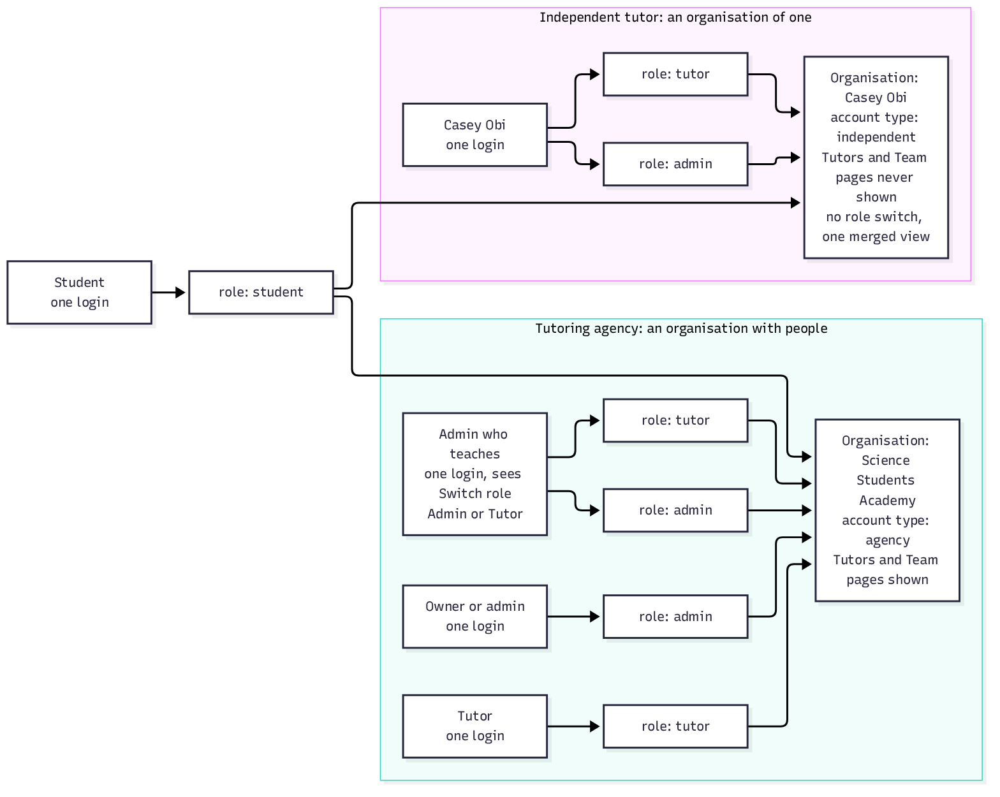

# Independent tutor and tutoring agency: how each works

Status: draft for owner review, 28 Nov 2026. Uses the updated Bobbin atlas
(`research/bobbin-appatlas`, commit `c49a8fb`) and the redesign specs. The model
in section 2 (D-22) was **approved on 28 Nov** and is applied to the specs, and
**I teach too** is removed (D-29).

## 1. What the atlas update showed

The new folder `17-admin-tutor-role-test` tested an admin who is also a tutor, on
Bobbin's live app. Results:

- Typing the admin's own email in **Tutors, Add tutor** does not send an
  invitation. Bobbin recognises the person and asks: "{Name} is already an admin
  here. Add them as a tutor too?" After **Add {Name} as a tutor** the tutor is
  created at once. No email, no acceptance.
- The same login then holds **two roles** in the organisation (administrator and
  tutor). The account menu gains **SWITCH ROLE: Admin / Tutor**.
- In **Tutor** mode the menu loses Clients, Tutors, Team, Report approvals,
  Safeguarding, Unlinked sessions and organisation settings. It keeps Dashboard,
  Calendar, Lessons, Courses, Students, Recordings, Resources and personal
  Settings, and the dashboard shows the teaching schedule and reports to write.
- Switching back to **Admin** restores everything. Both switches worked live.

**A correction.** Earlier I told you Bobbin sends an admin to a separate tutor
account. That was wrong. Bobbin's join-dialog line ("join from that account
instead") means this role switch. I have fixed the wording in my notes (below).

Bobbin has no "independent tutor" type. Everyone, even a one-person business, is
an organisation. That is a useful hint for the model below.

## 2. The model (approved, D-22)

One person has one login. A login can hold roles in organisations: **admin**,
**tutor** or **student**. An **independent tutor is an organisation of one**
whose owner holds both the admin and tutor roles.

- **Independent tutor:** no team. The Tutors and Team pages are hidden, and there
  is no role switch, because there is nobody else to be an admin over. One merged
  view: the tutor screens plus the owner's powers (create courses, add students,
  settings, data).
- **Agency:** the team flag is on. Admins see everything. Tutors see only their
  own courses. An admin who also teaches holds both roles and gets **Switch
  role**.
- **Student:** a role in one or more organisations.

Why this model, in plain terms:

| Reason | What it means |
|---|---|
| One code path (D-19) | Independent and agency are the same product with a flag. No separate screens to build and keep in sync |
| Reuses the tutor view | In Tutor mode an admin sees exactly what an agency tutor sees, so it is built and tested once |
| Simple permission checks | Each request is judged in one active role, not a blend |
| Cleaner admin screens | An admin who teaches is not shown admin clutter while teaching |
| Proven | It is what Bobbin does, tested live |

### Options compared

| | A. Toggle only (old spec) | B. Two roles and Switch role (chosen) |
|---|---|---|
| How an admin starts teaching | **I teach too** in My profile | **Add me as a tutor** (setup step, Tutors page), or their own email in Add tutor |
| What they see while teaching | The admin view, with tutor items added and a **Mine only** toggle | Tutor view, identical to an agency tutor's |
| Extra build | Rules inside the admin view (tutor lists, reminders, attendance) | A role switch in the account menu, using the tutor view that already exists |
| Risk | Admin view grows more complex over time | A person can forget which role they are in. The role is shown in the account card |
| Independent tutor | Separate account type with its own rules | Organisation of one, same code |

**I teach too is removed (D-29).** It would be a second way to do the same
thing. There is now one path: **Add me as a tutor** adds the tutor role with no
email, and **Switch role** is how the admin moves between views. The button sits
where an admin looks first (the setup step, the Tutors page and its empty
state), so the feature stays easy to find.

### How it is stored (changed after the impact check)

The user sees two roles, but the database keeps **one membership per person per
account** and gives an admin a `can_teach` flag. Two rows would break an existing
uniqueness rule and could duplicate people in lists. See `09-impact-check.md`.

## 3. Side by side

| | Independent tutor | Tutoring agency |
|---|---|---|
| What it is | An organisation of one | An organisation with admins and tutors |
| Chosen at | Kavi: **On my own** | Kavi: **With a team**, then the agency name |
| Roles | One person holds admin and tutor | Admins, tutors, and admins who also teach |
| Setup list | Add students, Create course, Build plan, Schedule first lesson, Check classroom | Add a tutor (or add yourself), Add students, Create course, Build plan, Schedule first lesson |
| Pages | No Tutors, Team | Tutors, Team |
| Create courses, add students | Yes | Admins only |
| Lesson wizard | No tutor choice | Tutor choice |
| Dashboard | One tutor view | Admin view, or Tutor view after Switch role |
| Classroom | Always the tutor | Admin Lead or Watch, or teach as Tutor |
| Settings | Personal plus General (timezone, currency) | Admins also set agency name and logo in General |
| Emails to students | "Michael Chen via Kanvise" | "Science Students Academy" |
| Concerns | Go to Kanvise support | Go to admins |
| Extra messages | None | Daily summary at 7 AM for admins |
| Payout (proposal) | The tutor's own bank account | The agency's bank account |

## 4. Independent tutor, start to finish

## 5. Agency, start to finish

Things to notice:
- A tutor invited to an agency does not create courses or add students. They see
  only courses the admin gives them, and an empty state says so.
- An admin invited to an existing agency skips setup (the owner already did it).
- Students can belong to more than one tutor or agency with one login.

## 6. Growing from solo to team

Nothing is deleted when someone goes either way. Going back to **On my own** is
only allowed when no other team member is active.

## 7. The admin who also teaches

## 8. Money (proposal)

Kanvise holds the Paystack account and pays organisations out (owner, 28 Nov).
Recommendation (OQ-12): **one payout bank account per organisation**. An
independent tutor uses their own. An agency uses the agency's, and the agency
pays its own tutors. Kanvise does not split money among an agency's tutors. This
keeps Kanvise out of employment and tax questions it has no reason to enter.

## 9. Spec edits made for D-22 and D-29

Applied on this branch (spec checker passes):

- `01` SH-06: **Switch role** in the account menu, remembered per device (OQ-13). SH-02
  user card shows the active role.
- `19` TM-10: rewritten as **Add yourself as a tutor, and Switch role**. TM-01 empty
  state and header show **Add me as a tutor**. TM-03 recognises your own email.
- `12` CFG-P: the **I teach too** toggle is gone. CFG-N and the Data section follow.
- `07` CR-09: the dialog says to switch to your Tutor role.
- `02`, `04`, `05`, `17`, `18`, `20`: every mention of **I teach too** reworded.
- `12` CFG-T: the confirm dialog when moving to a team (diagram 19) is still to add.

## 10. Other things the atlas update added

Not yet applied, and for you to look at:

- **Sign-in and invitations (`16-auth-responsive`, 44 states at three screen
  sizes).** Bobbin's invitation page lets someone with an existing account
  **Accept** or **Decline**, and has pages for invitations that are expired,
  already accepted, declined or withdrawn. Its reset link works once and lasts 48
  hours, and recovery says the same thing whether or not the account exists. It
  also has a two-factor challenge and reset. I would add **Decline** for tutor
  invitations and the declined and withdrawn states to `21-sign-in-and-sign-up.md`
  (D-23). Two-factor stays later.
- **Sign-up form.** Bobbin asks for name, company, country, phone, consent and a
  bot check. Kanvise asks only name, email and password, and gets country and
  timezone later in General. I would keep it that way.
- **First-time setup order.** Bobbin's checklist runs client, tutor, student,
  course, first lesson, the same shape as ours without clients.
- **`18-ai-plan-control-audit`** (53 files on generating and editing an AI course
  plan). I have not read it. It is relevant to `04` CRS-06 and CRS-04.

## 11. Decisions and questions

| ID | Item | Recommendation |
|---|---|---|
| D-22 | Two roles plus **Switch role** for admins who teach; independent tutor is an organisation of one | **Approved 28 Nov** |
| D-23 | Tutor invitations can be **declined**, with declined and withdrawn states | **Approved 28 Nov, applied** |
| D-29 | Remove the **I teach too** toggle. **Add me as a tutor** plus **Switch role** replace it | **Approved 28 Nov, applied** |
| OQ-12 | One payout account per organisation | **Approved, applied in 13** |
| OQ-13 | Is the chosen role remembered when someone signs in again? | **Approved:** yes, per device |
