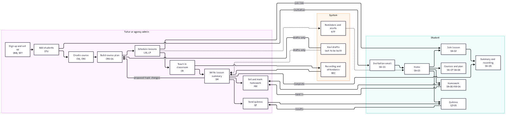

# Kanvise user flows

Status: draft for owner review. Written 28 Nov 2026 from the redesign specs on
`design/redesign-spec` (`docs/design/redesign/00` to `20`). Where this folder
and a spec disagree, the spec wins until it is updated, except for the
numbered decisions in `03-decisions-and-open-questions.md`, which are
proposed changes to the specs.

## What is in here

| File | What it gives you | Who it helps |
|---|---|---|
| `01-user-flows.md` | Every journey as a diagram, with the steps, error and edge cases, and the spec IDs to open | Product, design, devs |
| `02-state-machines.md` | The life cycle of a lesson, invitation, homework, quiz, links, recording, topic status, student account and invoice | Devs, QA |
| `06-account-types.md` | How an independent tutor and a tutoring agency each work, side by side, with the admin-who-teaches role switch (proposal D-22) | Owner, product, devs |
| `07-screens-by-account-type.md` | Every screen, and what an independent tutor, agency admin, agency tutor and student each see | Design, devs, QA |
| `08-ai-plan-bobbin-comparison.md` | What Bobbin's AI course plan does and what Kanvise takes from it | Product, design |
| `09-impact-check.md` | What D-22 and D-29 could break (including a database constraint) and how each was handled | Devs, QA, owner |
| `03-decisions-and-open-questions.md` | Judgment calls made while writing this, and what still needs the owner | Owner |
| `04-payments.md` | A payment flow design for when billing is built (proposal) | Owner, devs |
| `05-gamification.md` | A progress and motivation design that fits the redesign (proposal) | Owner, design |
| `qa/01-qa-test-plan.md` | About 260 test cases tied to flow and spec IDs, plus cross-cutting checks | QA, devs |
| `qa/02-ai-qa-tooling.md` | How AI agents are changing QA in 2026 and what to adopt here | QA, devs |
| `DIAGRAMS.md` and `diagrams/all-diagrams.pdf` | Every diagram on one page, and as one 30-page PDF | Everyone |
| `diagrams/` | PNG of every diagram, and the Mermaid source in `diagrams/src/` | Everyone |

## Terms

- **User flow:** the steps and screens one person takes to finish one task,
  including decisions and failures. Most files here are user flows.
- **User journey:** the whole experience over time, including things outside
  the app (a WhatsApp message, an email). The system map shows this view.
- **State machine:** one object (a lesson, an invoice) and every state it can
  be in, with what moves it between them.

## How to read a diagram

- Rounded boxes are start and end points. Diamonds are decisions.
- Boxes with IDs such as `LP-05` or `NTF-207` point at the spec that owns that
  screen or message. Open the spec for the exact copy and rules.
- Dotted arrows are things that happen in the background or on another device.
- Lane titles (Tutor, Student, System) show who acts.

## Changing a diagram

The source is plain text in `diagrams/src/*.mmd` (Mermaid). To redraw the PNGs:

```
npm i -D @mermaid-js/mermaid-cli
for f in docs/design/user-flows/diagrams/src/*.mmd; do
  n=$(basename "$f" .mmd)
  npx mmdc -i "$f" -o "docs/design/user-flows/diagrams/$n.png" -s 2 -b white
done
```

GitHub also renders `.mmd` content pasted into a fenced `mermaid` block, so a
reviewer can read the source in a pull request.

## The one-page picture



## What the specs do not cover yet

These are the gaps found while building the flows. Each one has a decision or
a question in `03-decisions-and-open-questions.md`.

- Sign-in, sign-up and forgot-password screens (waiting for Bobbin screenshots).
- Collecting payment (billing is on hold). See `04-payments.md`.
- Motivation features from the old Kanvise Experience document. See `05-gamification.md`.
- Several edge states for homework, quizzes, recordings and invited admins.
